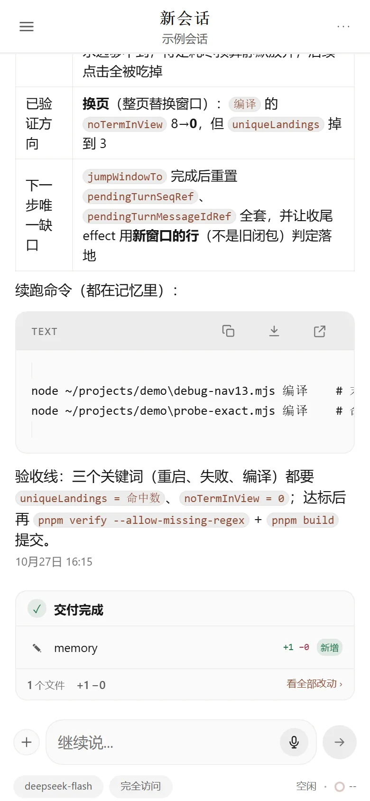
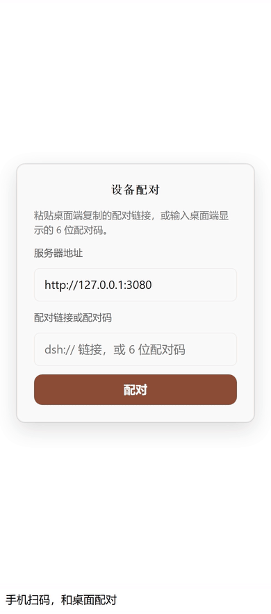
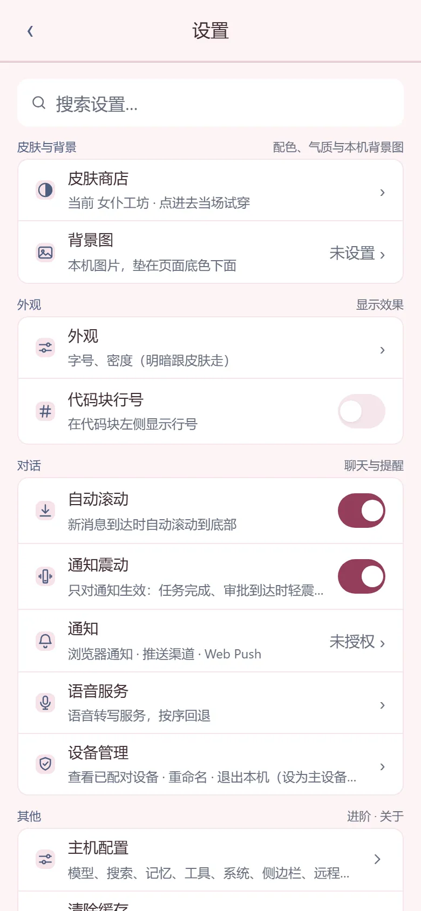
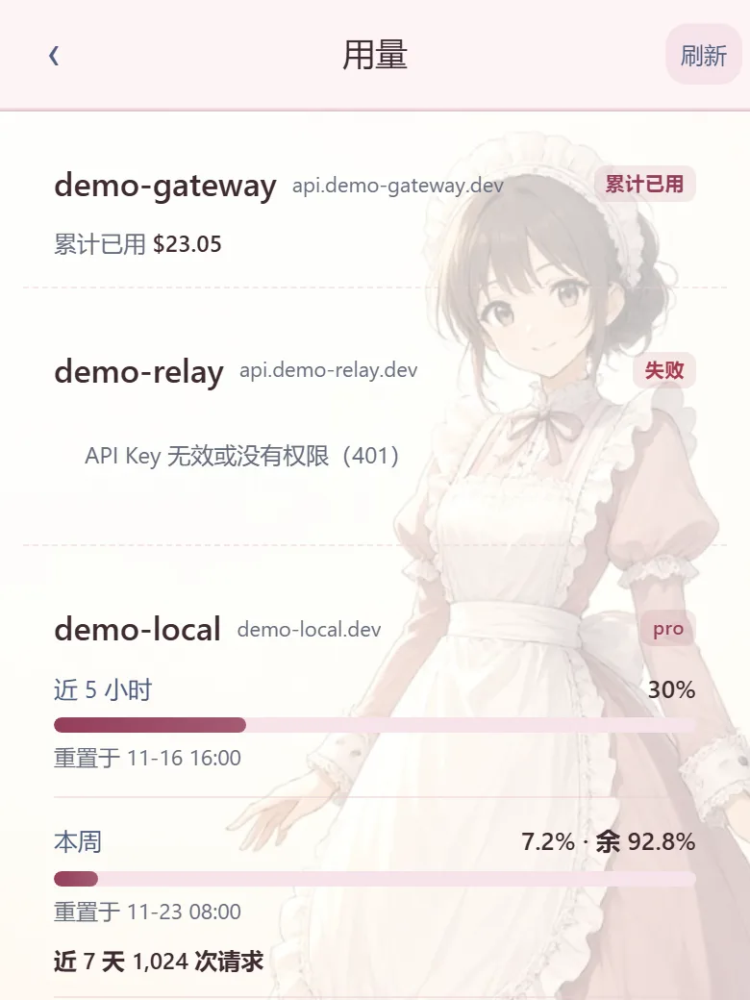

# dsh-palm

[简体中文](README.md) | [English](README.en.md)

[](https://www.npmjs.com/package/@eternalloveone/dsh-palm)
[](https://github.com/Eternalloveone/dsh-palm/actions)
[](https://github.com/Eternalloveone/dsh-palm/blob/main/LICENSE)

**把 [dsh](https://github.com/deepseek-ai/deepseek-harness) 搬到手机上。** 同一个会话、同一份进度、同一套权限——人在外面也能看见 agent 在干什么，随手回一句、点个同意。

它不是另一个工作台，是你桌面上那个 dsh 的**手机端**。



**目录**：[开始](#三条命令开始) · [它是什么](#它是什么什么时候用) · [功能](#功能总览) · [界面](#界面一览) · [安全与数据](#安全和数据) · [常见问题](#常见问题) · [要求](#要求与兼容) · [文档](#文档)

## 三条命令开始

```sh
# 1. 装插件（在你的 dsh 机器上）
dsh plugin --profile web add @eternalloveone/dsh-palm

# 2. 重启 dsh，让它加载（按你平时的启动方式，例如）
dsh web
```

```text
# 3. 桌面侧边栏点「手机」图标 → 手机扫码，或手输面板上的 6 位码
```

手机能打开 `/m/` 就算装好了，不用装 App。

> 手机和电脑不在同一个网络？看 [手机怎么访问到这台机器](docs/remote-access.md)。

## 它是什么，什么时候用

你在电脑上让 agent 干活——跑测试、改代码、整理资料。以前只要离开电脑，就只能等：它跑到哪一步了？有个操作要你同意，你不在，它就干等着；想到一句话要补充，只能回去坐下。

dsh-palm 把这几件事搬到手机上：

| 你原来的处境 | 现在 |
|---|---|
| 离开电脑就断线 | 手机上看到全部工作区正在跑什么、做到第几步、跑了多久 |
| 审批等不到人，任务空耗 | 要你同意的事推到手机，当场点同意或拒绝 |
| 想补一句得回到桌前 | 手机直接发，还能排队、撤回、打断 |
| 跑完不知道 | 手机会响（微信 / iOS / Telegram），点开就是那个会话 |

一天里大概是这样：通勤时看一眼跑到第几步，开会时点掉一个审批，午休补一句话，下班路上收到「任务完成 · 3 个交付物」。

**手机不做什么**：装插件、改权限预设、编辑复杂配置——这些回桌面做。手机上只放高频动作。

## 功能总览

七类，每类只列最能说明问题的几条；完整清单（约 50 项）见 [能力清单](docs/capabilities.md)。

| 类别 | 你能做的 |
|---|---|
| **看进度** | 一屏看全所有工作区在跑什么、第几步、跑多久；一轮折叠成过程条，点开是完整时间线；结束的落进「刚结束」带结果摘要 |
| **对话** | 打字 / 拍照 / 发文件 / 语音（60 秒内，边录边出字幕）；一轮没跑完也能先排队，可改、可删、可打断 |
| **审批** | 工具审批和提问实时推到手机，就地同意或拒绝，不会被别的设备抢答 |
| **管会话** | 长按置顶 / 重命名 / 删除；搜索直达某条消息；交付物收进一张卡；抽屉里显示当前模型的真实余额 |
| **通知** | 三层到达：应用内 / Web Push / 微信·Telegram·Bark；三类事件各有独立开关 |
| **外观** | 24 套皮肤（各带自己的图标与背景）+ 换壁纸 + 字号密度 |
| **可靠** | 断线自动降级并切回、离线可先写、出错给可读错误页、可装成主屏幕应用 |

## 界面一览



> 42 秒录屏（循环播放、女仆工坊皮肤）：配对 → 会话列表 → 过程卡展开 → 流式回答与差异卡 → 交付卡 → 唤醒消息。数据全是虚构的，界面是真跑的。

| 会话抽屉 | 任务 / 运行总览 |
|---|---|
|  |  |
| **设置** | **皮肤商店** |
|  |  |
| **用量** | |
|  | |

> 真机截图，已脱敏：本机路径、项目名、会话标题和金额都换成了演示值，界面本身是真实运行的手机端。

| 页面 | 你能看到什么 |
|---|---|
| **首页** | 工作区卡片、全局搜索框、运行中快速入口（带跑动计数） |
| **会话列表** | 按工作区分组，置顶在上；搜索框、下拉刷新、长按出动作 |
| **对话页** | 消息流（含过程条、交付卡）、待发队列、目标条、输入工具条、右下角回合导航 |
| **侧边抽屉** | 工作区切换、会话列表、设置 / 用量 / 通知入口，头像可换皮肤 |
| **设置页** | 外观与背景、通知、权限、语音服务、关于 |

## 安全和数据

- **没有中转服务器**：手机直连你自己的电脑，dsh-palm 只是宿主上的一个插件
- **配对是设备级的**：扫码或 6 位码换一枚设备 cookie，存在本机 `$DSH_HOME/dsh-palm-devices.json`，随时可撤销
- **凭据不出宿主**：通知渠道的 token、API key 都只在电脑上，手机只看得到"配没配"
- **权限跟着桌面走**：手机上做不了超出你桌面权限的事

公网暴露怎么做才安全（哪些做法绝对不要用），见 [远程接入](docs/remote-access.md) 里的"安全铁律"。

## 常见问题

**手机打开是白屏 / 打不开**
先确认手机和电脑在同一个网络、路由器没开"客户端隔离"、防火墙放行了端口。地址建议直接用面板给的那个。

**收不到通知**
先点设置页的"发送测试"。测试成功但任务不响，是时长阈值或冷却挡住了；测试也失败，是那个渠道的 token 不对。

**能不能连多台手机**
可以，每台独立，互不影响，也能单独撤销。

**换了电脑 / 重装了 dsh**
重新扫码配对一次。设备表在 `$DSH_HOME/dsh-palm-devices.json`，跟着这个目录走。

**手机上能做桌面端所有事吗**
不能，也不打算做。手机上放的是高频动作：看、回、批、管。装插件、编辑权限预设这些回桌面。

**要不要装 App**
不用。浏览器打开，或者"添加到主屏幕"当应用用。iOS 想收 Web Push 必须添加到主屏幕。

**用久了变卡**
先退出重进（缓存会自动校正）；还不行就把现象告诉我。

**会不会很费流量**
列表和对话按需加载，打开哪个才拉哪个；断网时不会再空转。

## 要求与兼容

| 项 | 要求 |
|---|---|
| dsh | `>=0.2.1-rc.2 <0.3.0-0` |
| Node | `^22.19.0` 或 `>=24.0.0` |
| 手机 | Android 用 Chrome / Edge / Firefox；iOS 用 Safari 并"添加到主屏幕" |

手机端和宿主是分开升级的，升其中一边不会让另一边挂掉。从 1.x 升上来要注意什么，见 [UPGRADING](UPGRADING.md)；逐版本对应关系见 [COMPATIBILITY.md](COMPATIBILITY.md)。

## 文档

| 想了解 | 去哪 |
|---|---|
| 文档总索引 | [docs/README.md](docs/README.md) |
| 完整能力清单（更细） | [docs/capabilities.md](docs/capabilities.md) |
| 通知怎么配、收不到怎么排 | [docs/notifications.md](docs/notifications.md) |
| 手机怎么访问到电脑 | [docs/remote-access.md](docs/remote-access.md) |
| 1.x 升级注意 | [UPGRADING.md](UPGRADING.md) |
| 开发与发版 | [RELEASING.md](RELEASING.md) |
| 参与贡献 | [CONTRIBUTING.md](CONTRIBUTING.md) |
| 版本变更记录 | [CHANGELOG.md](CHANGELOG.md) |

## 出处与许可

dsh-palm 是 [dsh-remote-web-ui](https://github.com/zhu1090093659/dsh-web)（`@linxin666/dsh-remote-web-ui`，Apache-2.0）的衍生作品：配对协议、原始设备表格式和桌面面板骨架是继承的；整个 `/m/` 界面、渲染栈、`/m/api` 白名单、实时通道和离线层是重写的。细节见 [NOTICE](packages/dsh-palm/NOTICE)。

[Apache-2.0](LICENSE)
