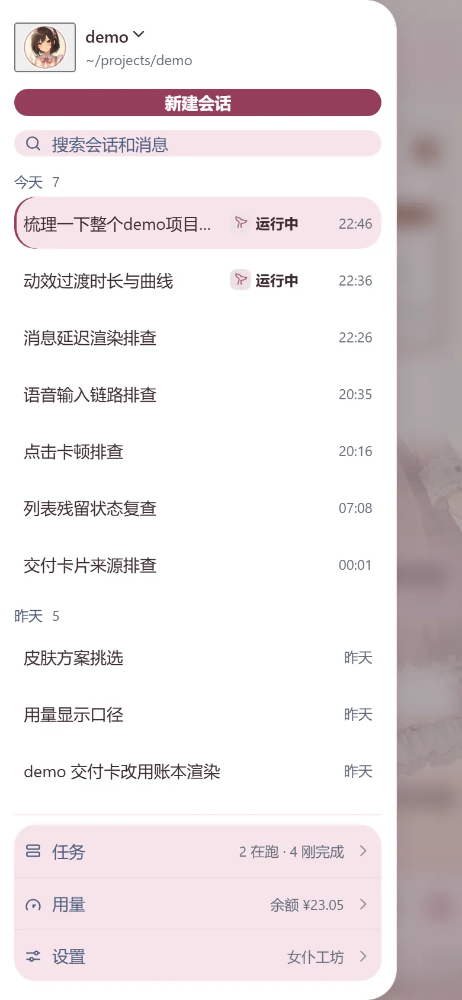
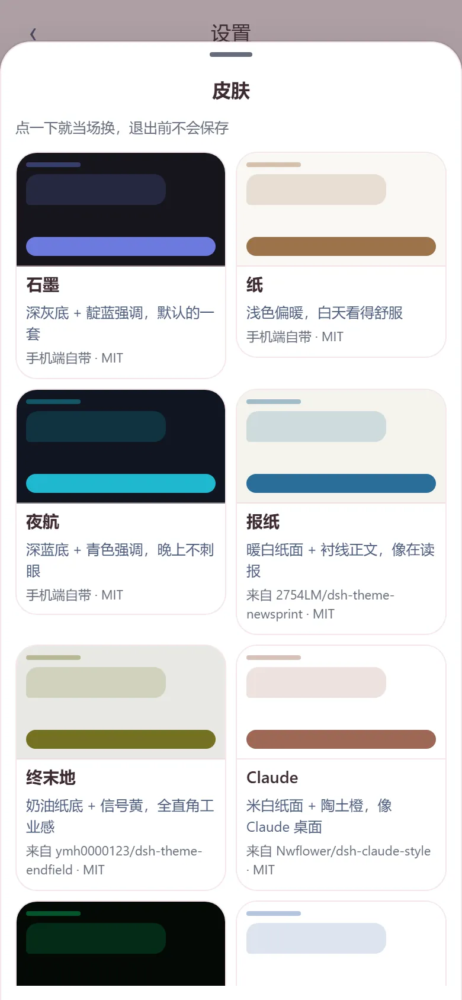

# dsh-palm

[简体中文](README.md) | [English](README.en.md)

[](https://www.npmjs.com/package/@eternalloveone/dsh-palm)
[](https://github.com/Eternalloveone/dsh-palm/actions)
[](https://github.com/Eternalloveone/dsh-palm/blob/main/LICENSE)

**把 [dsh](https://github.com/deepseek-ai/deepseek-harness) 搬到手机上。** 同一个会话、同一份进度、同一套权限——人在外面也能看见 agent 在干什么，随手回一句、点个同意。

它不是另一个工作台，是你桌面上那个 dsh 的**手机端**。

**目录**：[开始](#三条命令开始) · [它是什么](#这是什么解决什么问题) · [典型一天](#典型一天) · [功能总览](#功能总览) · [界面一览](#界面一览) · [安全与数据](#安全和数据) · [常见问题](#常见问题) · [要求与兼容](#要求与兼容) · [文档](#文档)

## 三条命令开始

```sh
# 1. 装插件（在你的 dsh 机器上）
dsh plugin --profile web add @eternalloveone/dsh-palm

# 2. 重启 dsh，让它加载（按你平时的启动方式，例如）
dsh web
```

```text
# 3. 桌面侧边栏点「手机」图标 → 手机扫码，或手输面板上的 6 位码
```

手机能打开 `/m/` 就算装好了，不用装 App。

> 手机和电脑不在同一个网络？看 [手机怎么访问到这台机器](docs/remote-access.md)。

## 这是什么，解决什么问题

你在电脑上让 agent 干活——跑测试、改代码、整理资料。以前只要离开电脑，就只能等：

- 它跑到哪一步了？卡住没有？
- 有个操作要你同意，你不在，它就干等着。
- 想到一句话要补充，只能回去坐下来。

dsh-palm 把这几件事搬到手机上：

| 你原来的处境 | 现在 |
|---|---|
| 离开电脑就断线 | 手机上看到全部工作区正在跑什么、做到第几步、跑了多久 |
| 审批等不到人，任务空耗 | 要你同意的事推到手机，当场点同意或拒绝 |
| 想补一句得回到桌前 | 手机直接发，还能排队、撤回、打断 |
| 跑完不知道 | 手机会响（微信 / iOS / Telegram），点开就是那个会话 |

**手机不做什么**：装插件、改权限预设、编辑复杂配置——这些回桌面做。手机上只放高频动作。

## 典型一天

早上出门前丢一个任务给它，剩下的时间在路上、在会议室、在饭桌上用手机盯着。

| 时刻 | 你想知道 / 想做 | 手机上 |
|---|---|---|
| 通勤地铁 | 昨晚那轮测试跑完没有 | 首页一屏看到「第 7 步 · 已跑 3 分钟」，点进去看结论 |
| 开会中 | 它要你同意一个写操作 | 通知弹出来，点同意，任务接着跑，不用离开会议 |
| 午休 | 想到一句要补充 | 打字发出去，这一轮自动带上；发错了还能撤回 |
| 下班路上 | 到底跑完没有 | 微信收到「任务完成 · 3 个交付物」，点开就是那份报告 |

## 功能总览

### 一、看它在忙什么

| 能力 | 说明 |
|---|---|
| **运行总览** | 一屏看完所有工作区正在跑什么：当前动作、第几步、跑了多久，点卡片直接进会话 |
| **状态条** | 待办计划和后台任务合并成工具条上方一条，实时刷新，不占地方 |
| **过程条** | 一轮对话折叠成一条"现在在干什么"，点开是完整时间线：思考、工具调用、改动 |
| **刚结束** | 跑完的会话不消失，落进「刚结束」，带结果、耗时和一句话总结 |
| **回合导航** | 长会话右下角有「当前 / 总轮」，点开看全部回合，按住横拖可以快速跳转 |
| **子代理** | 一轮里派出去的子代理都列出来，点进去能看它被交代了什么、每一步做了什么 |

### 二、对话与输入

| 能力 | 说明 |
|---|---|
| **中文输入** | 输入法组词期间不会把半截拼音发出去 |
| **图片** | 拍照或相册选，手机端先压缩再传，太大了会提示而不是悄悄丢掉 |
| **文件** | 一次最多 5 个、每个 20 MB，走你电脑的附件服务，消息本身只带回执 |
| **宿主文件** | 手机选不到文件时，可以直接翻这台电脑的目录，插一个 `@路径` 进去 |
| **语音** | 浏览器里直接录（最长 60 秒），可以配多家转写服务，边录边出字幕 |
| **斜杠命令** | 打 `/` 出命令面板，选中的命令锁成蓝色芯片，参数照旧可以改 |
| **待发队列** | 一轮没跑完也能先发，消息在工具条上方排队，可改、可删、可打断当前这轮 |
| **目标条** | 桌面上的 goal 同步到手机，能暂停、继续、展开看全文 |

### 三、审批与回答

- **工具审批**：要你点头的操作实时推到手机，就地同意或拒绝，不会被别的设备抢答
- **提问面板**：选择题和自由输入都支持，答完立刻继续
- **权限模式**：手机上看得到、切得动；复杂的预设建议回桌面改

### 四、管会话

| 能力 | 说明 |
|---|---|
| **会话抽屉** | 按工作区分组，显示真实项目名和完整时间；滑到底自动补更多 |
| **会话动作** | 长按一行：置顶、重命名、删除（删除要二次确认） |
| **全局搜索** | 首页搜所有工作区，按工作区分组；点结果直接跳到那条消息并高亮一次 |
| **会话内搜索** | 在会话列表里搜收窄到当前工作区，上下逐个跳，到边界才翻页 |
| **交付卡** | 一轮产出的文件和改动收成一张卡，最近一轮默认展开，历史可展开看 |
| **用量** | 抽屉里显示当前模型那家的真实数字：本周已用多少、余额多少 |

### 五、通知

三种到达方式，按你的手机选：

| 方式 | 什么时候能收到 | 说明 |
|---|---|---|
| 应用内通知 | App 开着 | 点一下直接进那个会话 |
| Web Push | App 关了、浏览器还在 | 安卓浏览器直连；iOS 要装到主屏幕 |
| 微信 / Telegram / Bark | 浏览器也退了 | WxPusher、服务器酱（微信）、Bark（iOS）、Telegram |

什么算"值得提醒"由你定：计划完成、后台任务、长回复三类各有独立开关，默认对后台任务和长回复保持安静；长回复要超过你设的时长才提醒，同一会话还有冷却，不会连环响。详细配法见 [通知](docs/notifications.md)。

### 六、外观

| 能力 | 说明 |
|---|---|
| **24 套皮肤** | 液态玻璃、赛博夜、龙裔、初音、我的世界、XP、深海流淌……不是换颜色，每套有自己的图标和笔画 |
| **壁纸** | 换成你自己的照片当背景，自动压缩、自动适配明暗 |
| **字号与密度** | 字号缩放、列表疏密、代码行号、自动滚动 |
| **主题同步** | 桌面端是深色，手机上也深色 |

### 七、可靠性与离线

| 能力 | 说明 |
|---|---|
| **断线自动降级** | 信号断了自动换成轮询，好了自己切回实时，不会一直转圈 |
| **离线也能先写** | 断网时消息存在手机上，回来自动发 |
| **不白屏** | 界面出错给一张能看懂的错误页，可以重试或重载 |
| **缓存不丢** | 长期放后台也不会把历史缓存清掉 |
| **装成应用** | 可以"添加到主屏幕"，像 App 一样打开，有独立图标和启动画面 |

### 八、还有

- **多台手机**：每台是一个独立设备，可以单独撤销
- **插件市场**：手机上也能浏览和装插件（复杂操作建议回桌面）
- **设置与桌面同步**：改过的设置两边一致
- **设置里能搜**：搜"通知""语音"这类词，直接跳到对应子页
- **检查更新**：关于页会告诉你有没有新版本

## 界面一览

**会话正文**：一轮对话折叠成过程卡，表格 / 代码块 / 行内命令照常渲染，交付物收进卡片，底部是输入与状态条。


| 会话抽屉 | 任务 / 运行总览 |
|---|---|
|  |  |
| **设置** | **皮肤商店** |
|  |  |

> 真机截图，已脱敏：本机路径、项目名、会话标题和金额都换成了演示值，界面本身是真实运行的手机端。

| 页面 | 你能看到什么 |
|---|---|
| **首页** | 工作区卡片、全局搜索框、运行中快速入口（带跑动计数） |
| **会话列表** | 按工作区分组，置顶在上；搜索框、下拉刷新、长按出动作 |
| **对话页** | 消息流（含过程条、交付卡）、待发队列、目标条、输入工具条、右下角回合导航 |
| **侧边抽屉** | 工作区切换、会话列表、设置 / 用量 / 通知入口，头像可换皮肤 |
| **设置页** | 外观与背景、通知、权限、语音服务、关于 |

## 安全和数据

- **没有中转服务器**：手机直连你自己的电脑，dsh-palm 只是宿主上的一个插件
- **配对是设备级的**：扫码或 6 位码换一枚设备 cookie，存在本机 `$DSH_HOME/dsh-palm-devices.json`，随时可撤销
- **凭据不出宿主**：通知渠道的 token、API key 都只在电脑上，手机只看得到"配没配"
- **权限跟着桌面走**：手机上做不了超出你桌面权限的事

公网暴露怎么做才安全（哪些做法绝对不要用），见 [远程接入](docs/remote-access.md) 里的"安全铁律"。

## 常见问题

**手机打开是白屏 / 打不开**
先确认手机和电脑在同一个网络、路由器没开"客户端隔离"、防火墙放行了端口。地址建议直接用面板给的那个。

**收不到通知**
先点设置页的"发送测试"。测试成功但任务不响，是时长阈值或冷却挡住了；测试也失败，是那个渠道的 token 不对。

**能不能连多台手机**
可以，每台独立，互不影响，也能单独撤销。

**换了电脑 / 重装了 dsh**
重新扫码配对一次。设备表在 `$DSH_HOME/dsh-palm-devices.json`，跟着这个目录走。

**手机上能做桌面端所有事吗**
不能，也不打算做。手机上放的是高频动作：看、回、批、管。装插件、编辑权限预设这些回桌面。

**要不要装 App**
不用。浏览器打开，或者"添加到主屏幕"当应用用。iOS 想收 Web Push 必须添加到主屏幕。

**用久了变卡**
先退出重进（缓存会自动校正）；还不行就把现象告诉我。

**会不会很费流量**
列表和对话按需加载，打开哪个才拉哪个；断网时不会再空转。

## 要求与兼容

| 项 | 要求 |
|---|---|
| dsh | `>=0.2.1-rc.2 <0.3.0-0` |
| Node | `^22.19.0` 或 `>=24.0.0` |
| 手机 | Android 用 Chrome / Edge / Firefox；iOS 用 Safari 并"添加到主屏幕" |

手机端和宿主是分开升级的，升其中一边不会让另一边挂掉。从 1.x 升上来要注意什么，见 [UPGRADING](UPGRADING.md)；逐版本对应关系见 [COMPATIBILITY.md](COMPATIBILITY.md)。

## 文档

| 想了解 | 去哪 |
|---|---|
| 文档总索引 | [docs/README.md](docs/README.md) |
| 完整能力清单（更细） | [docs/capabilities.md](docs/capabilities.md) |
| 通知怎么配、收不到怎么排 | [docs/notifications.md](docs/notifications.md) |
| 手机怎么访问到电脑 | [docs/remote-access.md](docs/remote-access.md) |
| 1.x 升级注意 | [UPGRADING.md](UPGRADING.md) |
| 开发与发版 | [RELEASING.md](RELEASING.md) |
| 参与贡献 | [CONTRIBUTING.md](CONTRIBUTING.md) |
| 版本变更记录 | [CHANGELOG.md](CHANGELOG.md) |

## 出处与许可

dsh-palm 是 [dsh-remote-web-ui](https://github.com/zhu1090093659/dsh-web)（`@linxin666/dsh-remote-web-ui`，Apache-2.0）的衍生作品：配对协议、原始设备表格式和桌面面板骨架是继承的；整个 `/m/` 界面、渲染栈、`/m/api` 白名单、实时通道和离线层是重写的。细节见 [NOTICE](packages/dsh-palm/NOTICE)。

[Apache-2.0](LICENSE)
